# JS Deep Clone Benchmark for Bun

This is a benchmark for JS deep clone libraries for Bun.

## Benchmark Results

for Node please refer to [Node](README.md)

cpu: 13th Gen Intel(R) Core(TM) i5-13400F

runtime: bun 1.3.11 (x64-win32)

### json

| Library | small (ops/s) | large (ops/s) |
| -- | --: | --: |
| @ungap/structured-clone | 33,739 | 3,324 |
| clone | 32,013 | 353 |
| clone-deep | 167,530 | 956 |
| clone(circular) | 28,233 | 2,092 |
| copy-anything | 37,780 | 437 |
| core-js/structured-clone | 12,614 | 1,553 |
| deepcopy | 12,506 | 1,100 |
| es-toolkit.cloneDeep | 48,160 | 3,109 |
| fast-copy | 168,416 | 5,254 |
| fastest-json-copy | 254,480 | 1,660 |
| JSON.stringify/parse | 39,932 | 707 |
| jsondiffpatch.clone | 85,480 | 1,423 |
| just-clone | 19,789 | 358 |
| klona | 75,417 | 1,306 |
| klona/json | 87,958 | 1,467 |
| klona/lite | 78,981 | 1,304 |
| lodash.cloneDeep | 21,456 | 1,147 |
| nano-copy | 65,732 | 5,801 |
| nanoclone | 66,364 | 7,397 |
| plain-object-clone | 31,234 | 533 |
| ramda.clone | 10,280 | 708 |
| rfdc | 38,145 | 665 |
| rfdc(circles) | 37,151 | 643 |
| structuredClone | 32,807 | 3,275 |

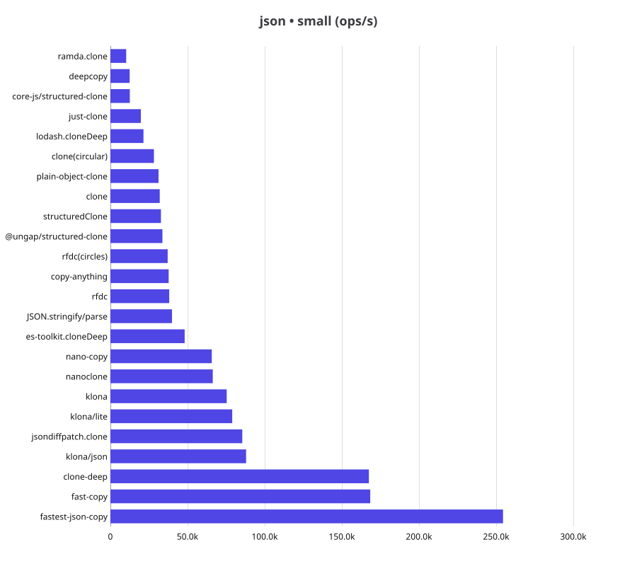
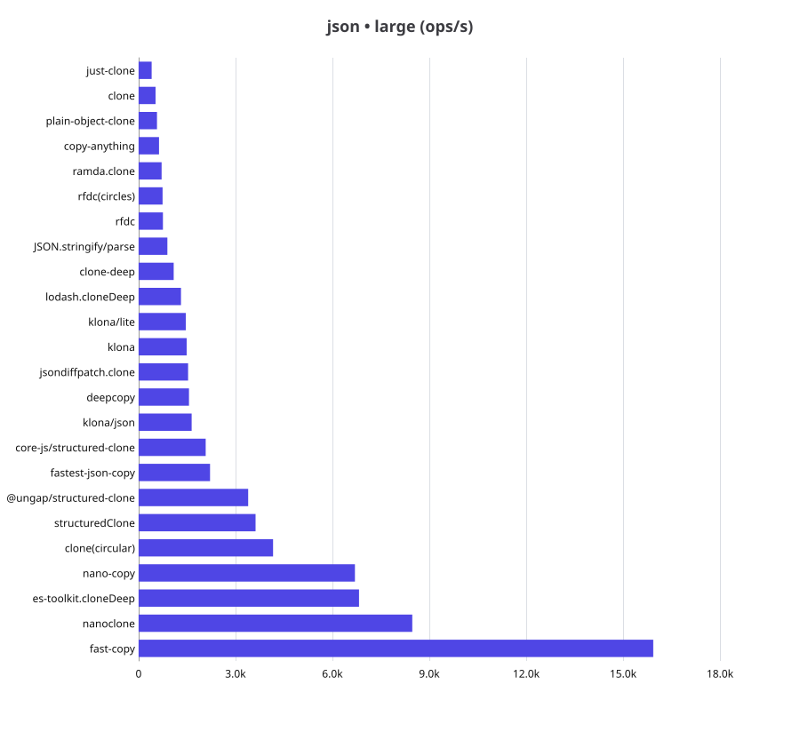

### json-circular

| Library | small (ops/s) | large (ops/s) |
| -- | --: | --: |
| @ungap/structured-clone | 472,430 | 674 |
| clone(circular) | 499,832 | 270 |
| core-js/structured-clone | 342,305 | 250 |
| deepcopy | 340,479 | 251 |
| es-toolkit.cloneDeep | 777,260 | 992 |
| fast-copy | 1,243,520 | 2,687 |
| lodash.cloneDeep | 559,147 | 60 |
| nano-copy | 1,359,256 | 3,016 |
| nanoclone | 1,917,625 | 1,754 |
| ramda.clone | 304,057 | 56 |
| rfdc(circles) | 1,407,489 | 1,051 |
| structuredClone | 478,870 | 673 |

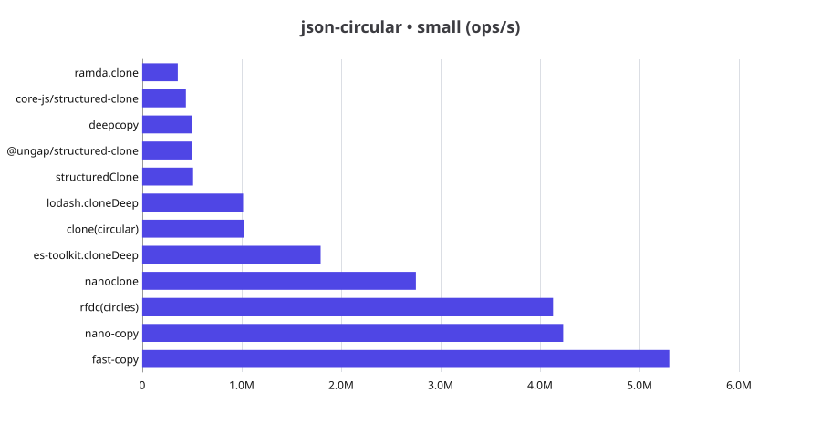
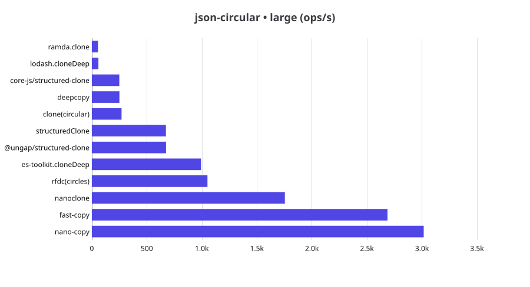

### regexp

| Library | small (ops/s) | large (ops/s) |
| -- | --: | --: |
| @ungap/structured-clone | 71,310 | 10,725 |
| clone | 69,089 | 969 |
| clone-deep | 46,235 | 522 |
| clone(circular) | 62,616 | 6,926 |
| core-js/structured-clone | 29,610 | 3,184 |
| deepcopy | 21,391 | 2,251 |
| es-toolkit.cloneDeep | 56,527 | 6,352 |
| fast-copy | 64,842 | 7,623 |
| jsondiffpatch.clone | 52,851 | 749 |
| just-clone | 80,359 | 1,178 |
| klona | 72,431 | 1,072 |
| klona/lite | 73,612 | 1,073 |
| lodash.cloneDeep | 26,196 | 1,998 |
| nano-copy | 173,699 | 14,719 |
| nanoclone | 205,354 | 15,942 |
| ramda.clone | 28,742 | 2,497 |
| rfdc(with RegExp) | 66,143 | 969 |
| structuredClone | 71,936 | 10,743 |

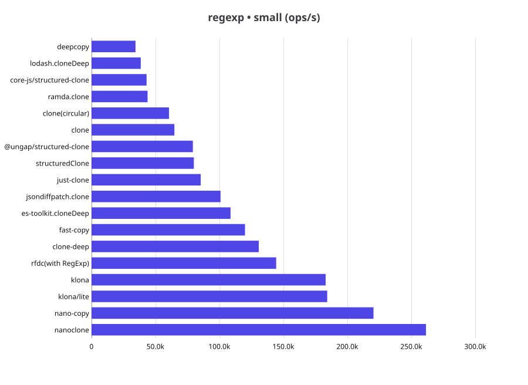
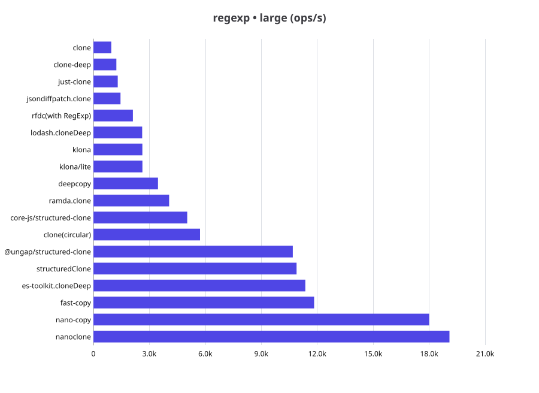

### date

| Library | small (ops/s) | large (ops/s) |
| -- | --: | --: |
| @ungap/structured-clone | 52,373 | 17,207 |
| clone | 84,988 | 859 |
| clone-deep | 105,382 | 1,058 |
| clone(circular) | 65,304 | 7,141 |
| core-js/structured-clone | 16,171 | 2,731 |
| deepcopy | 15,676 | 3,210 |
| es-toolkit.cloneDeep | 63,206 | 17,969 |
| fast-copy | 123,144 | 17,469 |
| jsondiffpatch.clone | 105,998 | 2,037 |
| just-clone | 46,129 | 855 |
| klona | 74,486 | 1,398 |
| klona/lite | 76,214 | 1,404 |
| lodash.cloneDeep | 22,527 | 2,448 |
| nano-copy | 70,874 | 19,702 |
| nanoclone | 79,688 | 20,401 |
| ramda.clone | 19,545 | 3,762 |
| rfdc | 82,576 | 1,555 |
| rfdc(circles) | 81,195 | 1,546 |
| structuredClone | 52,192 | 17,297 |

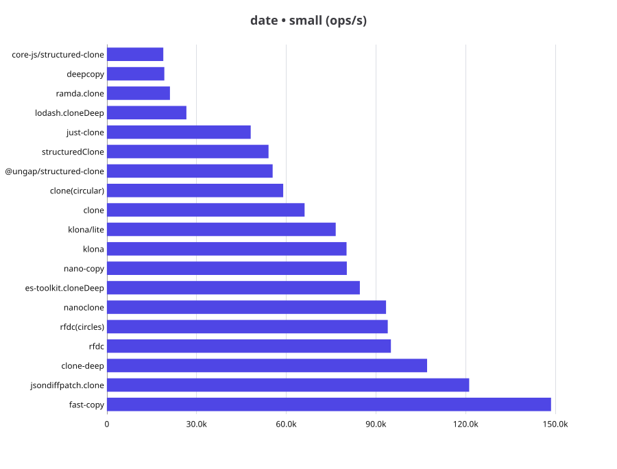
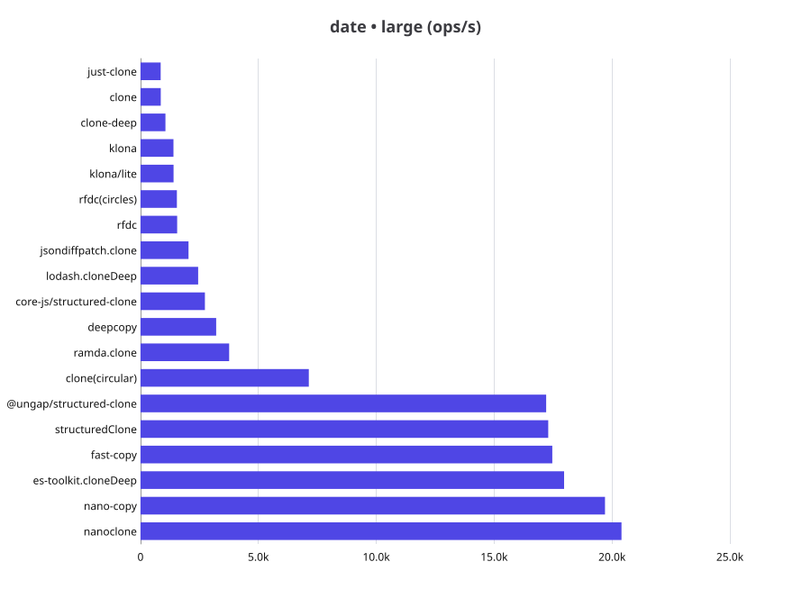

### custom-class

| Library | small (ops/s) | large (ops/s) |
| -- | --: | --: |
| clone | 629,118 | 1,936 |
| clone(circular) | 563,981 | 1,223 |
| es-toolkit.cloneDeep | 710,663 | 1,979 |
| fast-copy | 1,058,629 | 3,538 |
| klona | 1,974,668 | 5,626 |
| klona/lite | 2,014,350 | 5,970 |
| lodash.cloneDeep | 492,165 | 334 |
| nano-copy | 2,073,460 | 6,982 |
| ramda.clone | 234,370 | 308 |
| rfdc(with Custom Classes) | 1,602,817 | 3,991 |

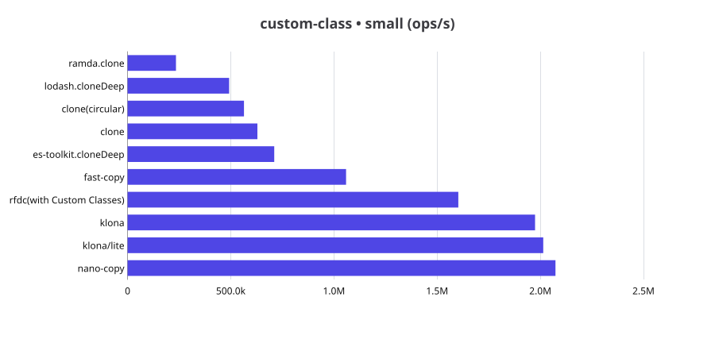
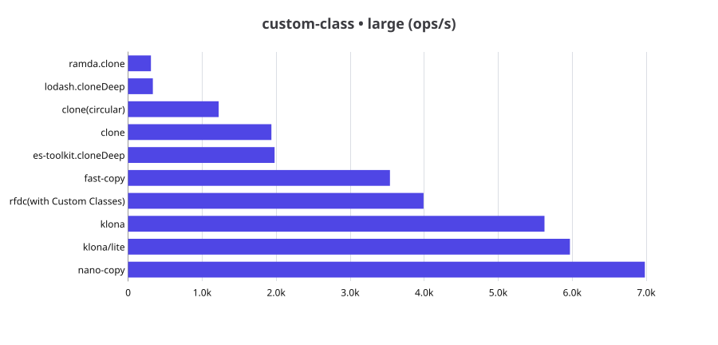

### array-buffer

| Library | small (ops/s) | large (ops/s) |
| -- | --: | --: |
| @ungap/structured-clone | 56,567 | 34 |
| core-js/structured-clone | 65,469 | 129 |
| es-toolkit.cloneDeep | 92,166 | 42 |
| fast-copy | 107,779 | 130 |
| klona | 107,212 | 130 |
| nano-copy | 112,128 | 131 |
| rfdc(with ArrayBuffer) | 110,206 | 130 |
| structuredClone | 57,157 | 34 |

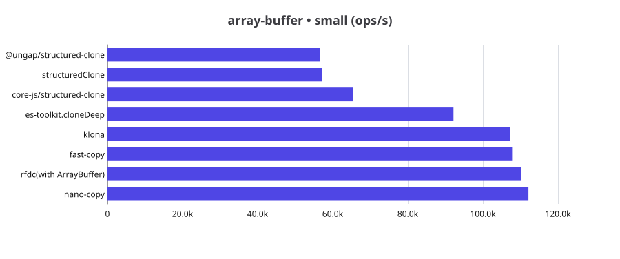
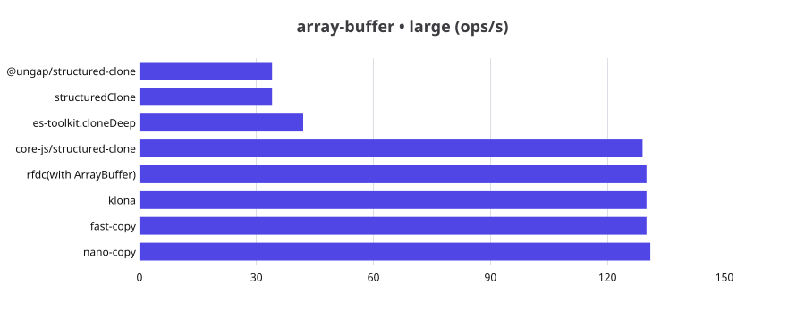

### buffer

| Library | small (ops/s) | large (ops/s) |
| -- | --: | --: |
| clone | 129,377 | 141 |
| clone(circular) | 128,428 | 142 |
| deepcopy | 54,820 | 72 |
| klona | 136,630 | 141 |
| nano-copy | 136,402 | 143 |
| rfdc | 139,837 | 142 |
| rfdc(circles) | 142,948 | 143 |

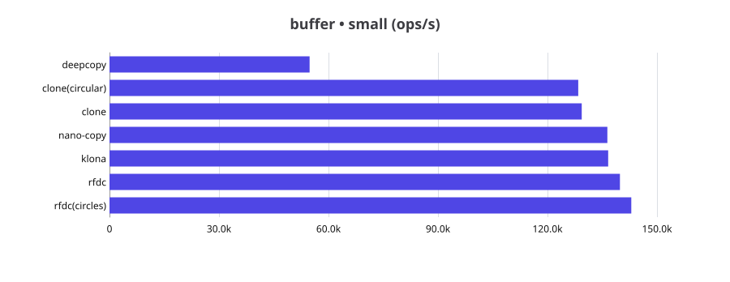
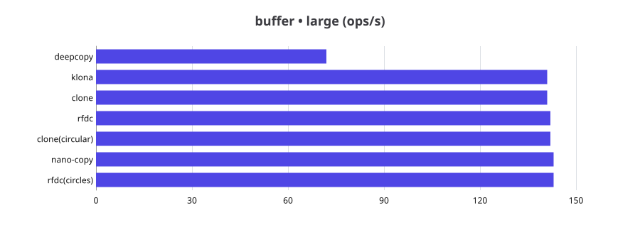

### buffer-zero-copy

| Library | small (ops/s) | large (ops/s) |
| -- | --: | --: |
| es-toolkit.cloneDeep | 611,731 | 699,617 |
| lodash.cloneDeep | 603,666 | 604,700 |

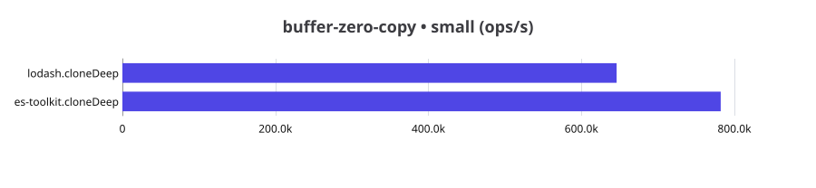
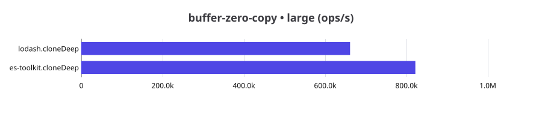

### map-set

| Library | small (ops/s) | large (ops/s) |
| -- | --: | --: |
| @ungap/structured-clone | 81,191 | 9,491 |
| clone | 219,815 | 29,698 |
| clone(circular) | 246,380 | 14,825 |
| core-js/structured-clone | 46,219 | 4,967 |
| deepcopy | 41,778 | 3,746 |
| es-toolkit.cloneDeep | 128,768 | 15,901 |
| fast-copy | 326,711 | 31,258 |
| just-clone | 107,757 | 10,860 |
| klona | 253,012 | 22,901 |
| lodash.cloneDeep | 104,991 | 6,564 |
| nano-copy | 71,476 | 12,458 |
| nanoclone | 154,631 | 24,522 |
| rfdc | 75,070 | 7,267 |
| rfdc(circles) | 76,627 | 7,568 |
| structuredClone | 81,334 | 9,498 |

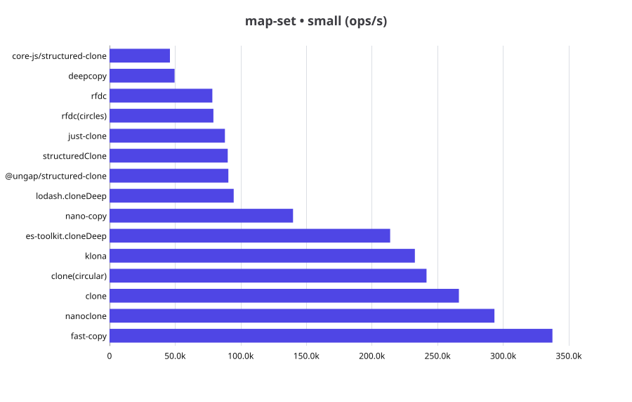
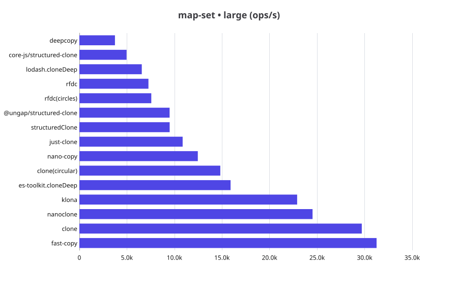
