# JS Deep Clone Benchmark

This is a benchmark for JS deep clone libraries.

## Clone Support Matrix

| Library | json | json-circular | regexp | date | custom-class | array-buffer | buffer | map-set |
| -- | -- | -- | -- | -- | -- | -- | -- | -- |
| @ungap/structured-clone | ✅ | ✅ | ✅ | ✅ | ❌ | ✅ | ❌ | ✅ |
| clone | ✅ | ✅ | ✅ | ✅ | ✅ | ❌ | ✅ | ✅ |
| clone-deep | ✅ | ❌ | ✅ | ✅ | ❌ | ❌ | ❌ | ❌ |
| copy-anything | ✅ | ❌ | ❌ | ❌ | ❌ | ❌ | ❌ | ❌ |
| core-js/structured-clone | ✅ | ✅ | ✅ | ✅ | ❌ | ✅ | ❌ | ✅ |
| deepcopy | ✅ | ✅ | ✅ | ✅ | ❌ | ❌ | ✅ | ✅ |
| es-toolkit.cloneDeep | ✅ | ✅ | ✅ | ✅ | ✅ | ✅ | ❌ | ✅ |
| fast-copy | ✅ | ✅ | ✅ | ✅ | ✅ | ✅ | ❌ | ✅ |
| fastest-json-copy | ✅ | ❌ | ❌ | ❌ | ❌ | ❌ | ❌ | ❌ |
| JSON.stringify/parse | ✅ | ❌ | ❌ | ❌ | ❌ | ❌ | ❌ | ❌ |
| jsondiffpatch.clone | ✅ | ❌ | ✅ | ✅ | ❌ | ❌ | ❌ | ❌ |
| just-clone | ✅ | ❌ | ✅ | ✅ | ❌ | ❌ | ❌ | ✅ |
| klona | ✅ | ❌ | ✅ | ✅ | ✅ | ✅ | ✅ | ✅ |
| klona/json | ✅ | ❌ | ❌ | ❌ | ❌ | ❌ | ❌ | ❌ |
| klona/lite | ✅ | ❌ | ✅ | ✅ | ✅ | ❌ | ❌ | ❌ |
| lodash.cloneDeep | ✅ | ✅ | ✅ | ✅ | ✅ | ❌ | ❌ | ✅ |
| nano-copy | ✅ | ✅ | ✅ | ✅ | ✅ | ✅ | ✅ | ✅ |
| nanoclone | ✅ | ✅ | ✅ | ✅ | ❌ | ❌ | ❌ | ✅ |
| plain-object-clone | ✅ | ❌ | ❌ | ❌ | ❌ | ❌ | ❌ | ❌ |
| ramda.clone | ✅ | ✅ | ✅ | ✅ | ✅ | ❌ | ❌ | ❌ |
| rfdc | ✅ | ✅ | ⚠️ | ✅ | ⚠️ | ⚠️ | ✅ | ✅ |
| structuredClone | ✅ | ✅ | ✅ | ✅ | ❌ | ✅ | ❌ | ✅ |

> ⚠️: need customize manually to support

## Benchmark Results

for Bun please refer to [Bun](README.bun.md)

cpu: 13th Gen Intel(R) Core(TM) i5-13400F

runtime: node 26.7.0 (x64-win32)

### json

| Library | small (ops/s) | large (ops/s) |
| -- | --: | --: |
| @ungap/structured-clone | 45,654 | 5,194 |
| clone | 20,931 | 362 |
| clone-deep | 107,516 | 1,810 |
| clone(circular) | 18,028 | 2,000 |
| copy-anything | 33,430 | 553 |
| core-js/structured-clone | 15,739 | 1,812 |
| deepcopy | 19,353 | 2,103 |
| es-toolkit.cloneDeep | 61,747 | 6,014 |
| fast-copy | 123,655 | 12,019 |
| fastest-json-copy | 224,319 | 3,783 |
| JSON.stringify/parse | 90,517 | 1,604 |
| jsondiffpatch.clone | 323,775 | 5,987 |
| just-clone | 24,392 | 419 |
| klona | 260,069 | 4,346 |
| klona/json | 330,567 | 5,592 |
| klona/lite | 299,938 | 4,974 |
| lodash.cloneDeep | 34,606 | 3,565 |
| nano-copy | 115,032 | 11,960 |
| nanoclone | 144,277 | 14,958 |
| plain-object-clone | 54,090 | 962 |
| ramda.clone | 10,341 | 634 |
| rfdc | 169,122 | 2,794 |
| rfdc(circles) | 156,791 | 2,499 |
| structuredClone | 46,059 | 5,205 |

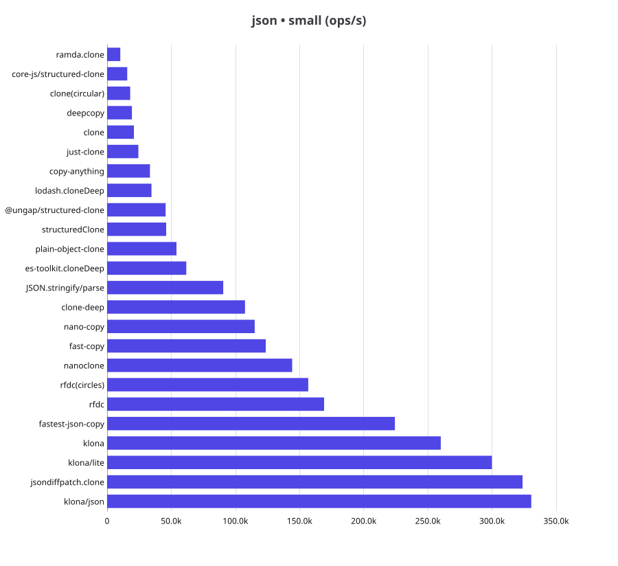
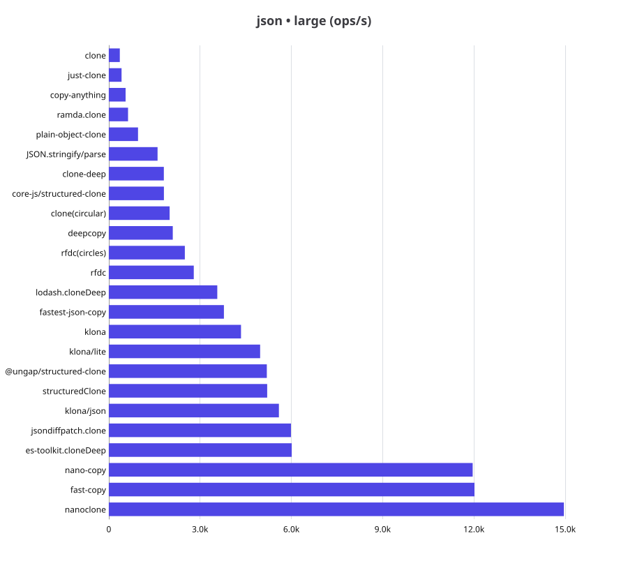

### json-circular

| Library | small (ops/s) | large (ops/s) |
| -- | --: | --: |
| @ungap/structured-clone | 619,282 | 885 |
| clone(circular) | 397,530 | 194 |
| core-js/structured-clone | 374,278 | 275 |
| deepcopy | 630,246 | 375 |
| es-toolkit.cloneDeep | 1,626,825 | 1,196 |
| fast-copy | 3,121,016 | 1,851 |
| lodash.cloneDeep | 1,019,148 | 662 |
| nano-copy | 2,809,979 | 1,965 |
| nanoclone | 3,781,593 | 2,331 |
| ramda.clone | 278,241 | 72 |
| rfdc(circles) | 4,034,051 | 2,553 |
| structuredClone | 610,232 | 893 |

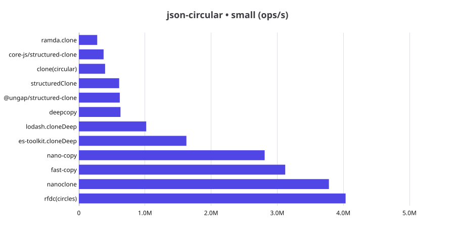
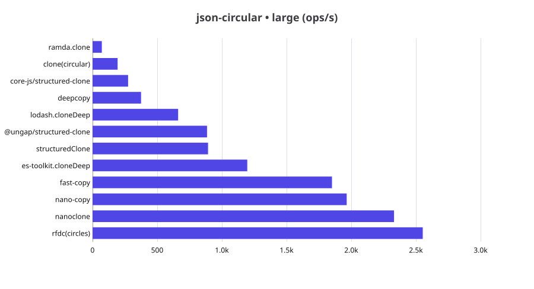

### regexp

| Library | small (ops/s) | large (ops/s) |
| -- | --: | --: |
| @ungap/structured-clone | 104,200 | 13,255 |
| clone | 54,245 | 859 |
| clone-deep | 171,252 | 2,759 |
| clone(circular) | 44,422 | 4,701 |
| core-js/structured-clone | 46,594 | 5,809 |
| deepcopy | 51,917 | 6,986 |
| es-toolkit.cloneDeep | 153,386 | 17,024 |
| fast-copy | 170,342 | 19,032 |
| jsondiffpatch.clone | 91,977 | 1,730 |
| just-clone | 97,950 | 1,482 |
| klona | 352,647 | 6,083 |
| klona/lite | 390,972 | 6,460 |
| lodash.cloneDeep | 38,244 | 3,722 |
| nano-copy | 161,864 | 20,412 |
| nanoclone | 233,102 | 25,067 |
| ramda.clone | 41,056 | 4,227 |
| rfdc(with RegExp) | 311,976 | 5,195 |
| structuredClone | 100,441 | 12,947 |

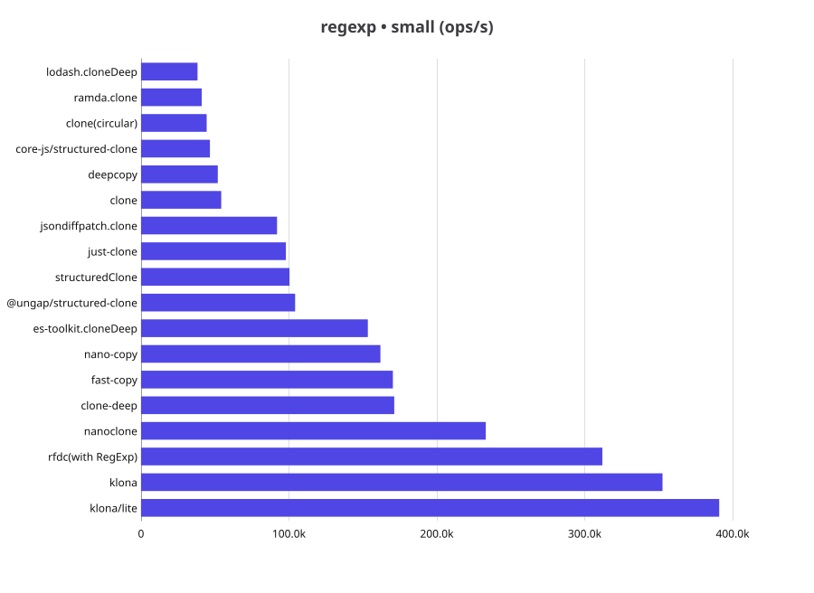
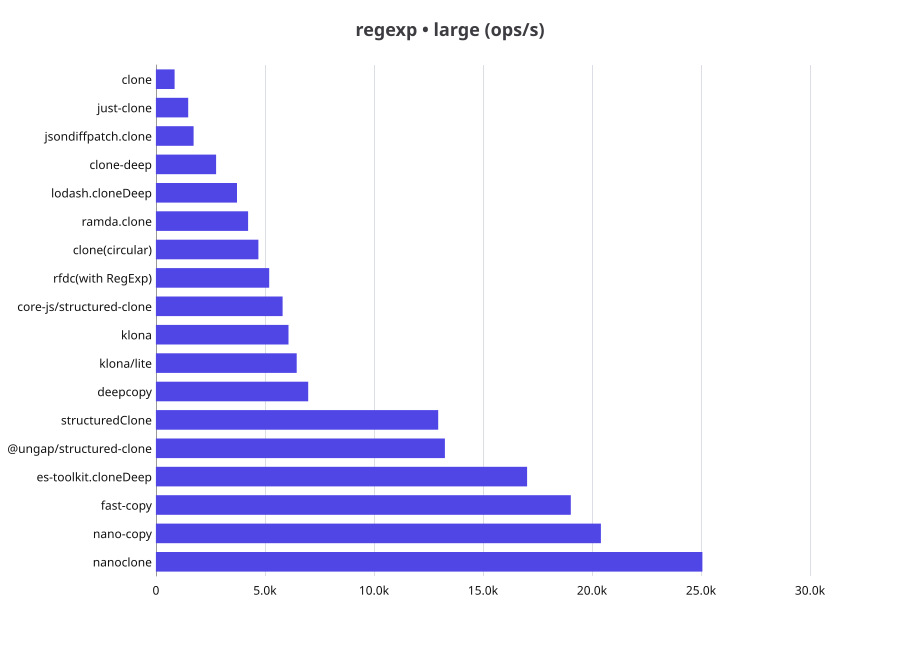

### date

| Library | small (ops/s) | large (ops/s) |
| -- | --: | --: |
| @ungap/structured-clone | 56,368 | 16,072 |
| clone | 27,170 | 486 |
| clone-deep | 82,890 | 1,509 |
| clone(circular) | 22,491 | 3,370 |
| core-js/structured-clone | 14,832 | 2,260 |
| deepcopy | 28,581 | 6,024 |
| es-toolkit.cloneDeep | 75,147 | 19,875 |
| fast-copy | 82,188 | 15,356 |
| jsondiffpatch.clone | 279,275 | 5,252 |
| just-clone | 51,726 | 942 |
| klona | 140,989 | 2,588 |
| klona/lite | 145,591 | 2,614 |
| lodash.cloneDeep | 32,967 | 5,140 |
| nano-copy | 105,413 | 18,059 |
| nanoclone | 137,265 | 25,314 |
| ramda.clone | 18,652 | 3,143 |
| rfdc | 204,633 | 3,616 |
| rfdc(circles) | 190,180 | 3,453 |
| structuredClone | 56,328 | 16,238 |

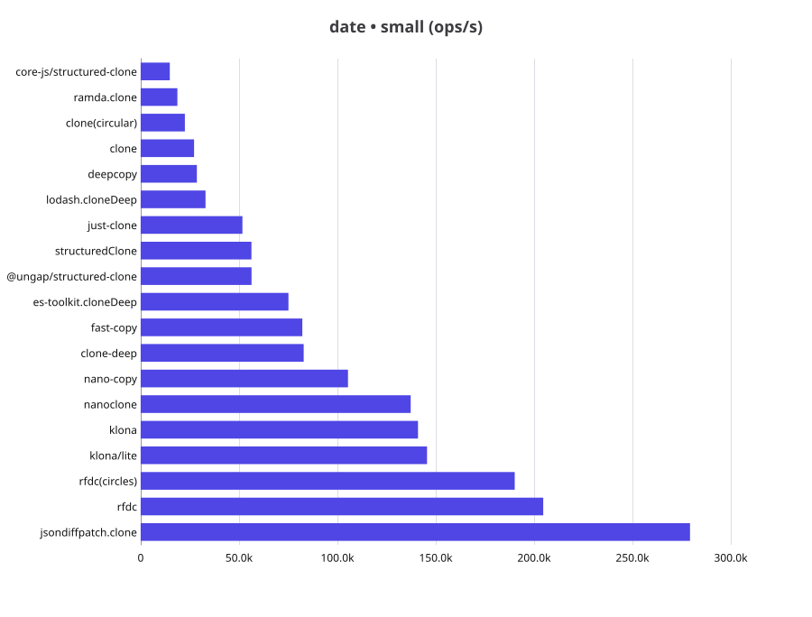
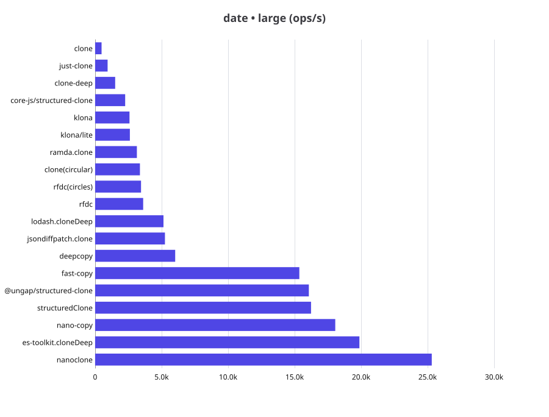

### custom-class

| Library | small (ops/s) | large (ops/s) |
| -- | --: | --: |
| clone | 388,417 | 1,191 |
| clone(circular) | 346,297 | 766 |
| es-toolkit.cloneDeep | 1,123,251 | 3,257 |
| fast-copy | 1,195,925 | 3,753 |
| klona | 2,014,139 | 6,670 |
| klona/lite | 2,184,488 | 7,112 |
| lodash.cloneDeep | 696,056 | 1,751 |
| nano-copy | 1,637,195 | 5,080 |
| ramda.clone | 225,226 | 394 |
| rfdc(with Custom Classes) | 3,529,579 | 10,429 |

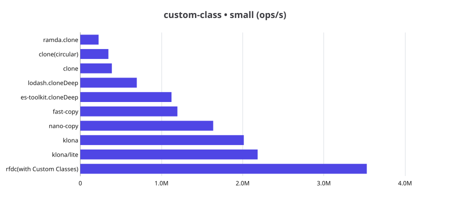
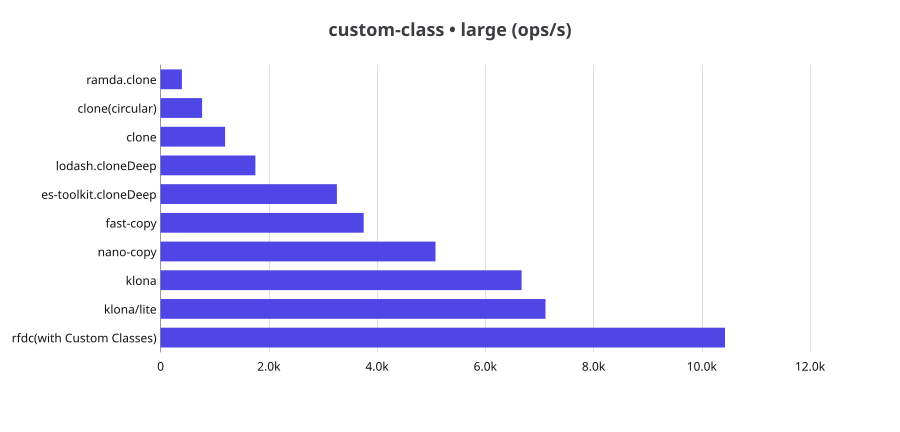

### array-buffer

| Library | small (ops/s) | large (ops/s) |
| -- | --: | --: |
| @ungap/structured-clone | 40,989 | 12 |
| core-js/structured-clone | 33,546 | 37 |
| es-toolkit.cloneDeep | 29,877 | 23 |
| fast-copy | 49,790 | 40 |
| klona | 48,387 | 39 |
| nano-copy | 51,624 | 39 |
| rfdc(with ArrayBuffer) | 49,892 | 39 |
| structuredClone | 39,789 | 12 |

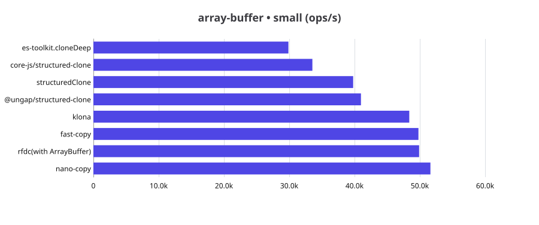
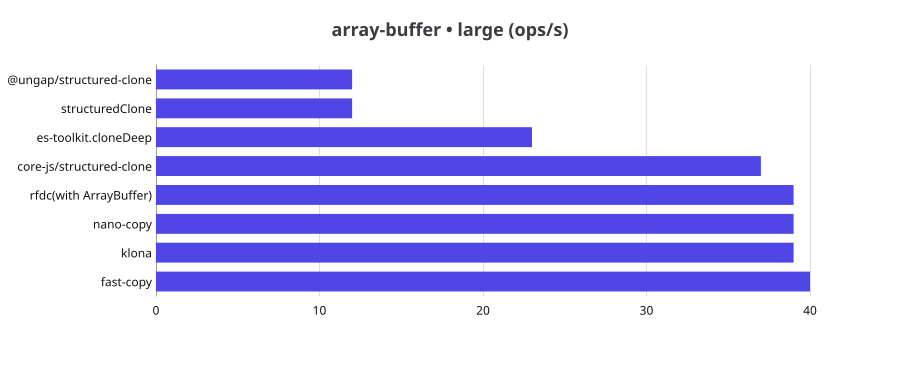

### buffer

| Library | small (ops/s) | large (ops/s) |
| -- | --: | --: |
| clone | 54,105 | 42 |
| clone(circular) | 59,384 | 42 |
| deepcopy | 33,445 | 23 |
| klona | 52,213 | 42 |
| nano-copy | 58,714 | 42 |
| rfdc | 54,635 | 42 |
| rfdc(circles) | 64,285 | 42 |

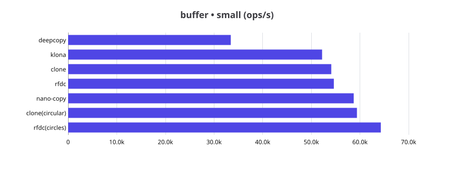
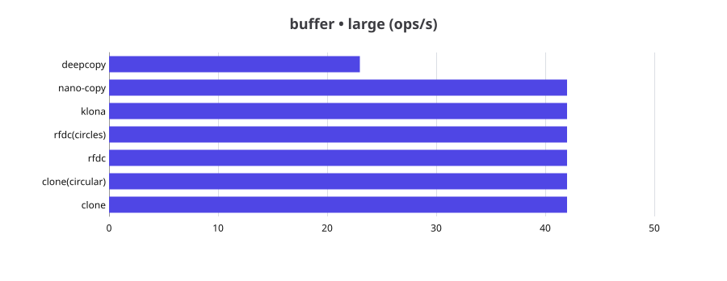

### buffer-zero-copy

| Library | small (ops/s) | large (ops/s) |
| -- | --: | --: |
| es-toolkit.cloneDeep | 1,016,738 | 1,006,102 |
| lodash.cloneDeep | 421,283 | 422,424 |

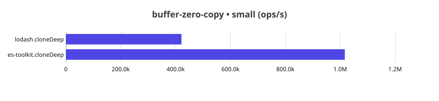

### map-set

| Library | small (ops/s) | large (ops/s) |
| -- | --: | --: |
| @ungap/structured-clone | 126,996 | 13,370 |
| clone | 115,352 | 10,942 |
| clone(circular) | 94,512 | 8,729 |
| core-js/structured-clone | 47,656 | 4,812 |
| deepcopy | 95,692 | 9,197 |
| es-toolkit.cloneDeep | 295,602 | 27,700 |
| fast-copy | 269,128 | 24,648 |
| just-clone | 114,678 | 24,683 |
| klona | 415,678 | 38,509 |
| lodash.cloneDeep | 81,298 | 6,333 |
| nano-copy | 164,803 | 16,045 |
| nanoclone | 452,121 | 40,374 |
| rfdc | 172,712 | 21,794 |
| rfdc(circles) | 150,364 | 21,389 |
| structuredClone | 120,952 | 13,541 |

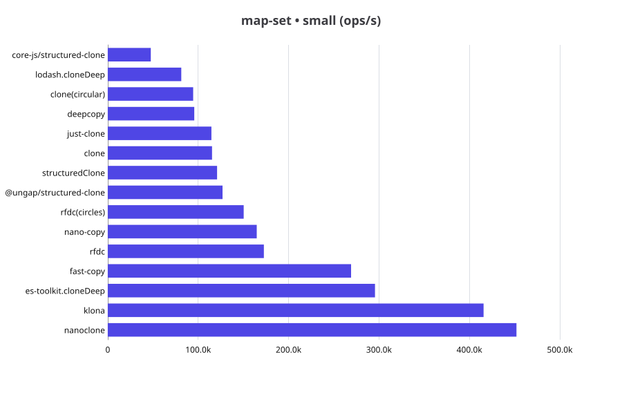
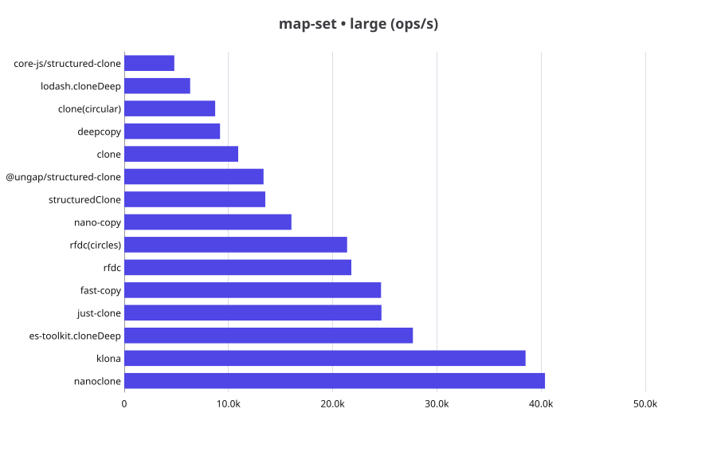
